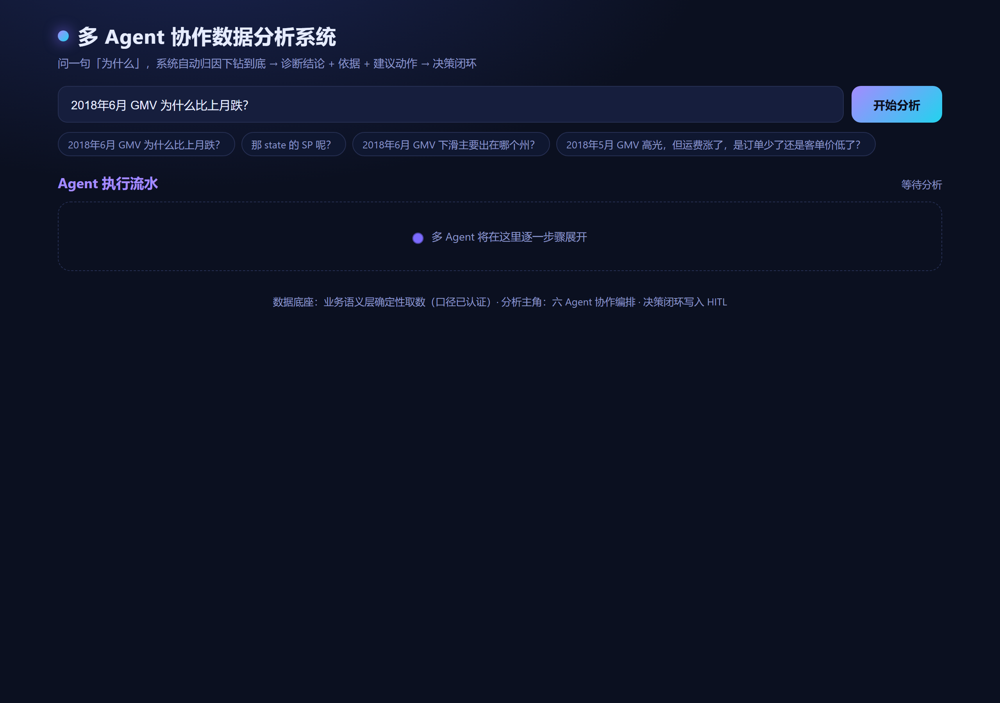
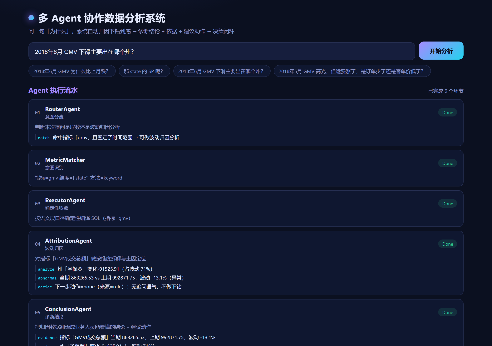
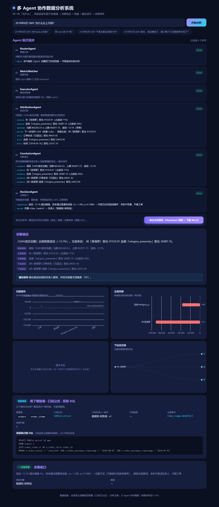
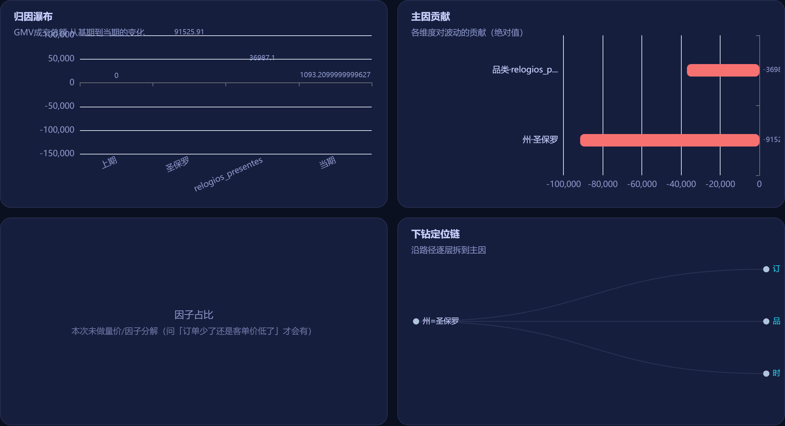
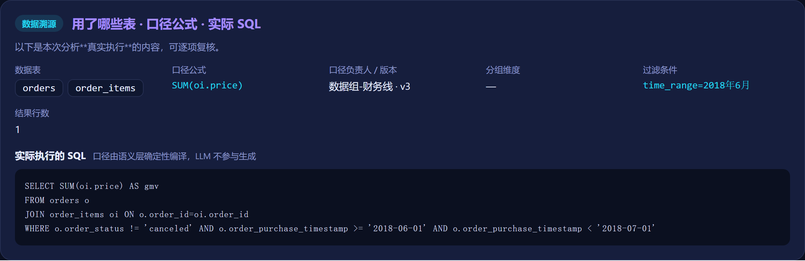
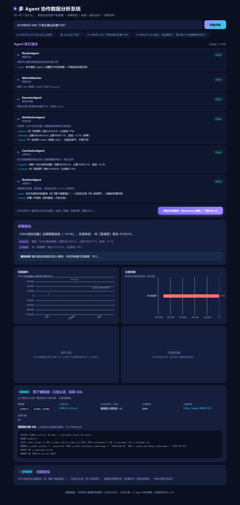
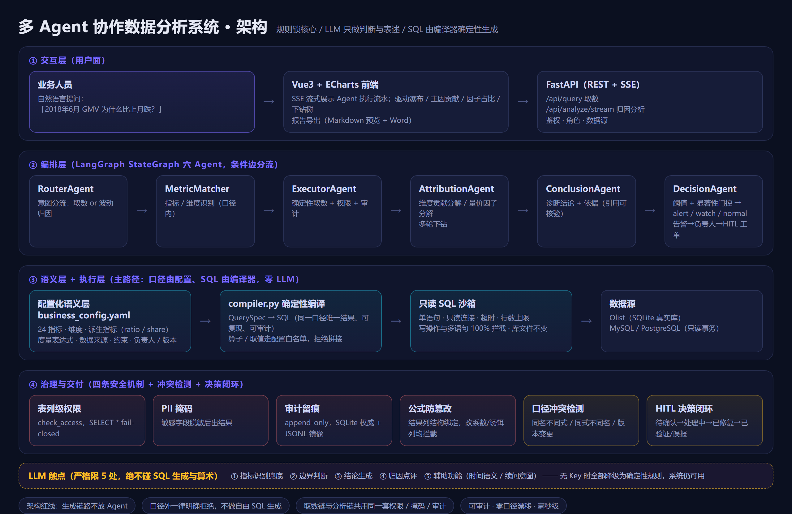
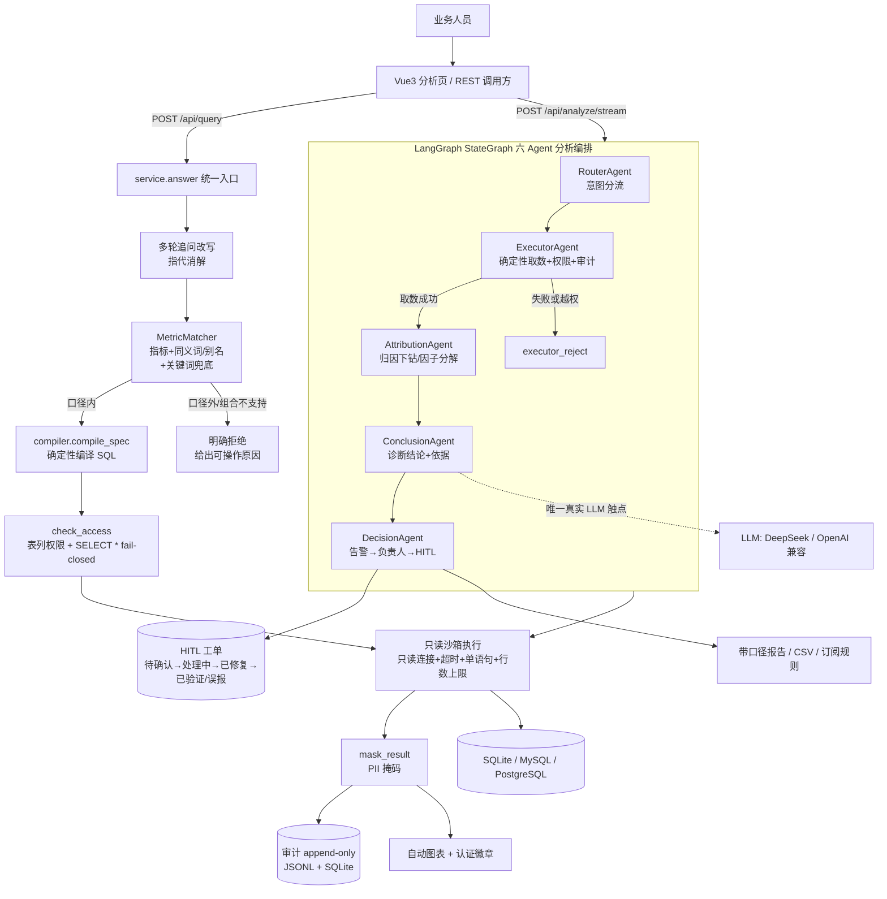

# 多 Agent 协作数据分析系统（语义层优先 · 归因下钻 · 决策闭环）

> 面向**业务人员**的**多智能体协作数据分析系统**：问一句「为什么」，系统像一支分析团队那样分工协作——
> **归因往下钻到底，输出「诊断结论 + 依据 + 建议动作」，并由决策 Agent 决定该不该告警、推给谁、写进 HITL 工单**。
>
> 底座是**配置化的业务语义层**（口径由代码确定性编译、可追溯、零 token）；**口径外的问题一律明确拒绝，
> 不做自由 SQL 生成**——生成链路不放 LLM 是本项目的架构红线；
> 两侧接治理面（口径冲突检测、异常归因与逐层下钻、会话级 Agent 记忆、HITL 决策闭环、报告导出）。
> 前端为 **Vue3 + ECharts**，全链路 **SSE 流式**把每个 Agent 的思考逐步推给用户，配炫的归因可视化（驱动瀑布/下钻树/因子占比）。
>
> **主交互**：取数只是入口，**归因逐层下钻（为什么跌 → 拆 → 再拆）+ 决策收口才是主戏**——「取数→归因→诊断→决策→HITL」构成一条完整分析链。

**它解决的不是"教业务写 SQL"**，而是两件真实的事：

1. **同一个指标，不同人算出不同口径** → 指标公式写在配置里、由编译器确定性生成 SQL，并标注负责人/版本；
2. **"这个数为什么涨跌、该不该告警、推给谁"** → 归因逐层下钻定位主因，异常自动带负责人进 HITL 闭环，并可导出带口径的报告。

分三层：

- **语义层（主路径）**：24 个配置化指标 + 4 个维度（dt 支持日/周/月/季）+ 3 个派生指标（比率/占比）。
  命中即由 `compiler.py` **确定性编译** SQL——LLM 不在生成路径上，故可审计、零口径漂移、零 token。
- **LangGraph 六 Agent 分析编排**：命中口径且圈定时间范围的问题，由 **StateGraph** 编排
  RouterAgent→ExecutorAgent→AttributionAgent→ConclusionAgent→DecisionAgent（条件边分流 + 归因下钻/因子分解），
  回答问题"为什么涨跌、要不要告警、推给谁"；口径未命中则明确拒绝并给出可操作原因（不做自由 SQL 生成）。
- **治理与交付**：口径冲突检测、指标口径解释（负责人/版本）、异常归因 + **多轮下钻**、
  HITL 闭环（带负责人与 AI 归因草稿）、**报告/CSV 导出**、订阅告警。

> **实现状态（诚实声明）**：语义层优先已落地（`path=semantic`）并在**外部公开基准**上量化覆盖率；
> `langgraph` 为真实依赖（非回退路径）；**自由 SQL 生成引擎（Writer↔Critic 评审 + 自愈重试）已整体删除**——
> 它的失败模式（口径漂移、无法审计、错误伪装成合理数字）不可接受，现在口径外一律明确拒绝；
> Chroma 长时记忆 / Checkpoint 未实现。
> 公式防篡改已从"子串包含"升级为**结果列结构绑定**（改系数/诱饵列/注释藏表达式均被拦截）。
> 未实现项不在此虚构为已实现。**逐轮修复记录（含回归测试）见 [`docs/changelog.md`](docs/changelog.md)。**

---

## 运行效果（实拍截图）

> 以下均为**真实 Olist 全量库**上跑出来的实拍图（`tools` 无参与），且**关闭 LLM**——
> 结论、归因、图表、SQL 全部来自确定性规则链路，可复现。

**① 提问入口**：一句自然语言，下面给出四个可直接点的演示问题（含定向追问「主要出在哪个州？」）。



**② Agent 执行流水（SSE 流式）**：每个环节的意图、判断与中间产物逐步推到前端，不是等一个黑盒结果。



**③ 完整结果页**：诊断结论 + 依据（量值可核验）+ 建议动作 + 四张归因图 + 数据溯源 + 决策收口。



**④ 归因可视化四图**：驱动瀑布 / 主因贡献 / 因子占比 / 下钻定位链；本次没产出的图会写明**为什么没有**。



**⑤ 数据溯源**：用到的表、口径公式、过滤条件、实际执行的 SQL 全部摊开——用户不必把系统当黑盒。



**⑥ 定向维度值追问**（「主要出在哪个州？」）：跳过告警评估，直接给主因定位（州 + 品类）。



---

## 核心特性

**一句话概括**：
> 语义层优先的**多 Agent 协作数据分析系统**：**24 个配置化指标 + 派生指标**由编译器确定性生成 SQL（口径可追溯到负责人/版本），
> 带时间范围的波动问题交给 **LangGraph 六 Agent 分析编排**（路由→执行→归因下钻→结论→决策）；
> 在此之上提供**口径冲突检测、异常归因与多轮下钻、会话级 Agent 记忆、权限/掩码/审计、HITL 决策闭环、
> 报告与 CSV 导出、订阅告警**。所有关键结论都有可复核的离线评测（含**注入式真因的归因命中率评测**）。

**外部可比性（不是自编题的自我评价）**：
> - **Spider dev `world_1`（第三方问题 + 第三方 gold SQL，N=120）**：覆盖率 **30/120 = 25.0%**
>   （语义层目标形态"单聚合"上 **28/48 = 58.3%**）、**覆盖内执行正确率 30/30 = 100%**、**敢答且答错 0 条**。
>   换域只改 1 个 YAML（`config/semantic_world.yaml`）、**0 行业务代码**。
>   两轮评测各改动了系统：① 修掉 3 条真实错答（拼写差异导致过滤静默丢失、"shortest"最值漏网、
>   "above the average"条件被忽略）；② 扩展 `QuerySpec` 表达力（集合/比较/区间/HAVING/否定反连接，
>   **算子走配置白名单**）把覆盖率从 **17.5% 抬到 25.0%**（目标形态 43.8% → 58.3%），**错答仍为 0**。
>   ⚠️ world_1 属 dev 集，建层时看过题面 → 25.0% 是**开发集覆盖率，不是泛化指标**；覆盖内正确率不受影响。详见
>   [`evaluation/reports/external_bank_world_1.md`](evaluation/reports/external_bank_world_1.md)。
> - **外部对抗语料（61 条）**：危险语料拦截 **48/48 = 100%**、库 sha256 与行数**一字未变**，
>   并首次度量**只读误杀率 1/13 = 7.7%**；该过程修掉 3 个真实漏洞（含"函数黑名单因大小写不匹配从未生效"）。
>   详见 [`evaluation/reports/sandbox_external.md`](evaluation/reports/sandbox_external.md)。

### 分析主角：六 Agent 协作编排（`src/sqlpa/analysis/orchestrator.py`）

这是把产品"主角"升级的关键——不再只是"生成一个数字"，而是**答完"为什么"并决定"怎么办"**：

| Agent | 职责 | 智能成色 |
|---|---|---|
| RouterAgent | 意图分流：取数 vs 波动归因 | LLM + 规则 |
| MetricMatcher | 定位指标/维度/时间范围（口径来自配置） | LLM + 关键词兜底 |
| ExecutorAgent | 编译 SQL → 只读沙箱取数（口径已认证） | 确定性 |
| AttributionAgent | analyze → decide_drill → factorize/drill 归因算术 | 确定性算数 + LLM 决策下一步 |
| ConclusionAgent | 把归因链翻成人话「诊断结论 + 依据 + 建议动作」 | LLM |
| DecisionAgent | 是否告警 → 推负责人 → 写 HITL 工单（带 AI 归因草稿） | 确定性 |

- **会话级 Agent 记忆**：每轮把主因建议写回一份工作记忆；下一轮「那 SP 呢？」这类省略式追问，靠记忆补全口径并沿上轮主因续钻（无需向量库，几个字段的 dict 足够）。同一 `(调用者, session_id)` 的并发分析被**串行化保护**，防止共享工作记忆被写撕裂。
- **口径待确认（HITL 前置，可信闭环）**：链路铁律是「**确定性保底、LLM 兜底、越界即拒绝**」。指标公式/维度/过滤全部取自配置；SQL 由编译器**确定性编译**，LLM 不碰 SQL。LLM 只做两件**兜底**：识别口径（从**已登记**的官方口径里选，不能即兴造新指标）、把归因翻成人话。当 MetricMatcher 用 LLM 推断口径（`method=llm`）而非确定性关键词命中时，**先停在确认门**：回显系统猜的口径 + 官方候选清单，等你确认/改选后才拉数并归因；而关键词命中、已确认、追问续钻都是确定性锁定，直接放行。
- **SSE 流式**：`/api/analyze/stream` 把 6 个 Agent 的 start/step/done 一个事件一个事件推给前端，逐卡片渲染。
- **归因可视化**：驱动瀑布 / 主因贡献条形 / 因子占比环形 / 下钻树，Vue3 + ECharts 呈现。

- **语义层优先（架构反转）**：命中语义层 → LLM 不在 SQL 生成路径上；口径表达式来自配置，响应带
  `path=semantic`、负责人、版本、数据来源。**口径外一律明确拒绝**（`matched=false` + 可读原因），
  不存在"降级生成未认证 SQL"的第二条路径。

### 架构红线：生成链路坚决不放 Agent

**"口径 → SQL"这一段永远由配置 + 编译器确定性产生，LLM 不得进入**——这是整个项目的卖点所在，
不是实现偏好：

- **可审计**：审计要能回答"这个数怎么来的"。LLM 生成的 SQL 只能被信任，不能被复核。
- **零口径漂移**：同一问句今天与明天必须编译出**逐字相同**的 SQL，否则"口径一致"是空话。
- **零 token**：主路径一旦花钱，覆盖率与成本就成反比，产品叙事整个倒过来。

一旦破了这条线，坍缩方式很具体：语义层从"认证源"降级为"提示词上下文"，治理面（口径冲突检测、
负责人/版本、未认证标注）随之**失去作用对象**——你无法对一段自由生成的 SQL 说"它违反了哪个口径"。
**治理论证依赖确定性，二者不是并列关系。**

红线边界是**显式且有测试守着**的（`tests/test_semantic_redline.py`，3 项）：

| 区域 | 内容 | 谁说了算 | 实测 |
|---|---|---|---|
| **生成区（红线内）** | `QuerySpec` → SQL | 配置 + 编译器 | 5 个 spec × 5 次编译**逐字相同**；毒化 LLM 走到编译器完全无感 |
| **判断区（允许 LLM）** | 自然语言 → `QuerySpec`（意图识别）、归因拆解、要不要继续下钻、升不升级 | LLM + 关键词/规则兜底 | 主路径唯一 LLM 触点：`_llm_match ← match ← answer`；产物带 `match_method` 可指认 |

> **实测数据（离线，可复现）**：不接 LLM、纯关键词匹配在 66 条业务问题上是 **指标认错 0 条 / 未命中 5 条**，
> 即意图识别这一层的 LLM 调用对这批问法并非必需。因此"意图识别漂移"是当前**唯一**的口径暴露面，
> 且其规模可度量——这也正是下一代改进方向（关键词优先、LLM 只补未命中，从而把暴露面压到 5 条以内）。

- **治理面**：口径冲突检测（四类场景：同名不同式 / 同式不同名 / 版本漂移 / 近义不同式）、口径解释、PII 掩码、表列权限、审计留痕、行级权限（RLS-lite）。
- **分析闭环**：异常归因按"维度贡献/乘法因子"拆解，支持**逐层下钻**（追问"那 SP 为什么跌"会自动深挖），
  异常阈值可配、自动带负责人进 HITL。归因查询失败会挂 `dim_errors` 并在结论中显式提示，不把"查不到"当"无波动"。
- **交付物**：带**口径说明**的 Markdown 报告 + CSV + Word（直接文件流下载）+ 订阅告警（与归因共用阈值口径）。
- **产品指标**：语义层命中率 / 口径外占比 / 认证率等，见"产品指标"一节（可复跑）。
- **组件评测**：业务语义层命中/治理护栏、归因决策评测、产品指标，以及**归因命中率（注入式真因）**，见 [`docs/evaluation.md`](docs/evaluation.md)（均可复跑）。

---

## 功能总览

| 页面/能力 | 说明 |
|---|---|
| 🧪 分析演示（Vue3 + ECharts） | **主前端页面**：六 Agent 分析链可视化 + 归因/下钻/决策，SSE 流式（`web/`） |
| 🛠️ 治理 / 复核看板（Vue3） | **新增前端页签**：并发拉取口径冲突 / HITL 待办 / 口径确认记录 / 订阅规则四格展示 |
| 💼 业务取数（API） | `POST /api/query`：口径内→配置公式硬约束（🛡️认证）；口径外→明确拒绝并给出可操作原因 |
| 🧭 多 Agent 分析（API） | `POST /api/analyze`、`/api/analyze/stream`、`/api/analyze/report`：六 Agent 编排 + SSE + 报告导出（Word 走文件流） |
| 📈 指标口径治理（API） | `GET /api/governance/conflicts`（冲突检测）、`GET /api/metrics/history`（变更历史）、`GET /api/metrics/lineage`（表/列血缘）、`POST /api/metrics/rollback`（回滚，仅 admin） |
| 🔔 订阅告警（API + CLI） | `GET/POST /api/subscriptions`、`DELETE /api/subscriptions/{id}`、`POST /api/subscriptions/check`；调度走 `tools/run_subscriptions.py`（cron）+ console/file/webhook 投递 |
| ⚙️ 指标中心（库层） | `metric_store` 提供指标/维度/别名的增删改与校验；**尚无对应 API/页面** |
| 🗄️ 数据源管理（API 只读） | `GET /api/datasources` 列出已注册数据源（密码掩码）；**注册/编辑为脚本或配置操作** |
| 📜 查询历史 / ⭐ 收藏 / 👍 反馈 | 数据表已在 `storage.py`（users/audit/feedback/favorites），**尚未暴露端点与页面** |
| 🔌 REST API | FastAPI：`/api/query` `/api/metrics` `/api/audit` `/api/datasources` `/health`，Swagger 在 `/docs` |
| 🎯 外部公开基准 | `evaluation/eval_external_bank.py`：第三方问题+gold SQL（Spider dev）判对错；覆盖率/覆盖内正确率/拒答归因三张表 |
| 🛡️ 外部对抗语料 | `evaluation/eval_sandbox_external.py`：48 条破坏性 + 13 条只读语料，报拦截率/**误杀率**/库不变性 |

> ⚠️ **与历史版本的差异**：早期 README 曾列出「登录认证 / 查询历史 / 收藏夹 / 指标中心 / 数据源管理」等
> Streamlit 页面。随 `app.py`（Streamlit 前端）下线、前端改为 Vue3 **只保留分析演示页 + 治理看板**，
> 上表已按仓库现状重写——文档不再描述不存在的界面。

> 📂 **目录结构**（含 `apiroutes/` 路由层、`src/sqlpa/` 模块、`tests/`、`evaluation/` 详解）
> 见 [`docs/architecture.md`](docs/architecture.md)。

---

## 系统架构



> 上图是四层架构总览（交互层 / 编排层 / 语义层+执行层 / 治理与交付），下面是同一结构的**数据流细化**：



> 关键设计：**推理交给 LLM（意图识别、归因讲解），执行/比对/护栏/口径公式交给确定性代码**——
> 杜绝大模型算错或篡改业务口径。生成链路（QuerySpec → SQL）**零 LLM**；
> 六 Agent 里只有 `ConclusionAgent` 与归因动作决策真的调 LLM，其余是确定性函数（README 不把它包装成六个智能体）。
> 取数链与分析链走**同一套**权限、掩码、审计与编译口径——不存在"分析入口绕过治理"的第二条路。

---

## 快速开始

> **开箱即跑**：仓库自带一份**样本库** `data/sample/olist_sample.db`（2.2MB，按天抽样覆盖 634 天）。
> `git clone` 之后**不需要下载 66MB 真实数据**，`pytest` 与前端演示都能直接跑。
> 需要全量口径时再按 [`docs/architecture.md`](docs/architecture.md) 说明导入真实 Olist（评测数字以全量库为准）。
> 归因在**真实全量库**上的命中率证据见 `evaluation/reports/attribution_full.md`；
> 外部公开基准与外部对抗语料的证据见 `evaluation/reports/external_bank_world_1.md`、`evaluation/reports/sandbox_external.md`。

```bash
git clone <repo> && cd <repo>
pip install -r requirements.txt
pytest tests -q                          # 全量离线测试（无需 Key、无需外部数据）
python evaluation/run_all.py             # 一次跑完全部 7 条离线评测线，汇总落 evaluation/reports/overall.json
```

### 方式一：一键启动（推荐）

```bat
start_api.bat        # 后端 http://localhost:8000/docs （生产/演示，不热重载）
start_api_dev.bat    # 后端（开发模式，带 --reload，改代码自动重启）
start_web.bat        # 前端 http://localhost:5173
```
或手动：`.venv\Scripts\python.exe -m uvicorn api:app --port 8000` + 在 `web/` 下 `npm run dev`。
前端在 **5173** 打开后，输入「2018年6月 GMV 为什么比上月跌？」即可看到六 Agent 流式执行 + 归因可视化 + 决策闭环。

> 也可用容器一键部署完整前后端：`docker compose up`，随后访问 `http://localhost:8080`。

### 方式二：本地（完整）

```bash
pip install -r requirements.txt
cp .env.example .env       # 填 LLM_API_KEY（DeepSeek/OpenAI兼容）；不填则离线模式

# 离线测试（无需 Key、无需外部数据）
pytest tests -q

# 前端（Vue3 + ECharts）
cd web && npm install && npm run lint && npm run test && npm run dev   # http://localhost:5173

# FastAPI 后端
uvicorn api:app --port 8000

# 真实 LLM 联调冒烟（在 Olist 上走完整六 Agent 分析链；无 Key 可加 --dry）
py tools/verify_real_llm.py

# 归因命中率评测（注入式真因，Ground Truth by Construction）
py evaluation/eval_attribution.py
```

### REST API 示例

```bash
curl -X POST http://localhost:8000/api/query \
  -H "Content-Type: application/json" \
  -d '{"question": "各个品类的GMV", "role": "analyst"}'
```

返回含 `mode`(metric)、`certified`(是否口径认证)、`sql`、`columns`、`rows`、`agent_trace`（多Agent编排链路）。

---

## 评测指标一览（7 条评测线，一次跑完）

> 跑法：`python evaluation/run_all.py`（**7 条线全部离线确定性、无需 API Key、可复现**），
> 汇总落 `evaluation/reports/overall.json`；加 `--llm` 再跑第 8 条 LLM 对照（无 Key 时显式标注"未运行"，不静默跳过）。
> CI 里这 7 条线由 `run_all.py` 一步跑完（`.github/workflows/ci.yml`）。
> 下表数字来自**真实 Olist 全量库**上的一次实跑，可逐条复算核对。**逐线方法学与口径说明见 [`docs/evaluation.md`](docs/evaluation.md)。**

| # | 评测线 | 关键指标 | 结果 | 产物 |
|---|---|---|---|---|
| 1 | 业务语义层（口径 / 治理护栏） | 口径内命中率 · 公式防篡改拦截率 · 权限拦截率 · PII 掩码覆盖率 · 审计覆盖率 | **100% × 5** | `business.json` |
| 2 | 产品模式（北极星=语义层命中率） | 语义层命中率 · 口径内执行成功率 · 指标/维度识别准确率 · 认证率 | **84.9% (56/66)** · 100% · 100% · 100% · 100% | `product.json` |
| 3 | 归因决策（离线规则基线） | 决策准确率（判定题数） | **81.2%**（判定题 6） | `decisions.json` |
| 4 | **归因三维定位（注入式真因）** | analyze 命中率 · top-3 · drill 命中率 · 量价因子分解命中率 | **53.6%** · 92.9% · 33.3% · 100% | `attribution.json` |
| 5 | 告警质量（阈值 vs 阈值+统计门控） | 阈值告警率 · 被统计门控抑制率 · 月长假象占比 | **77.8%** · 57.1% · 16.1% | `alert_quality.json` |
| 6 | 沙箱外部对抗语料（61 条） | 危险语料拦截率 · 只读误杀率 · 库不变性 · 过滤值转义合规率 | **100%** · 7.7% · 文件 sha256 与行数**一字未变** · 100% | `sandbox_external.json` |
| 7 | 第三方公开基准（Spider dev `world_1`, N=120） | 覆盖率（开发集口径） · 覆盖内执行正确率 · **敢答且答错** · 拒答率 | **25.0%** · 100% · **0** · 75.0% | `external_bank_world_1.json` |
| 8 | （可选，需 Key）确定性引擎 vs 纯 LLM | 引擎 top@1 − 纯 LLM top@1 = **llm_value** | 见 `--llm` 实跑 | `attribution_llm_baseline.json` |

**怎么读这张表（避免把数字读成"好看的假数据"）**：

- 第 4 条的 53.6% 是**注入式真因**下的 top-1 定位命中率（reports 里另有全量三档注入的 33.8%）；
  top-3 到 **92.9%**，说明主因基本在前三名内，只是排序没排到第一；drill 33.3% 是**已知短板**，明写不用 top-5 糊过去。
- 第 3 条 81.2% 是**离线规则基线**（不接 LLM 时判断题判不出）；接真实 LLM 的值另有 `decisions_llm.json`。
- 第 5 条**没有可信真值标注**，报的是"告警量的下降与成因结构"，**不是精确假阳性率**。
- 第 7 条 25.0% 是**开发集覆盖率**（`world_1` 属 dev 集，建层时看过题面），**不冒充泛化指标**；
  真正与"是否看过题面"无关的是"覆盖内执行正确率 100%"与"敢答且答错 = 0"。

---

## 测试与 CI

```bash
pytest tests -q --cov=src/sqlpa --cov=apiroutes   # 全量离线测试 + 覆盖率（本地基线约 83%，CI 门槛 80%）
```

- **测试范围**：沙箱安全 / 查询超时 / 配置化 / 方言适配 / 多Agent编排 / 分级放行 / 多轮 / 图表 / 指标CRUD / 数据源 / REST API /
  权限与掩码 / 行级权限 / 业务语义层 / 治理闭环 / 语义层编译器 / 语义层红线契约 / 口径真值对照 / 归因可加性与日历口径 /
  量价分解 / 统计门控 / 审计与可观测性 / 凭据加固 / 指标版本历史 / 订阅告警 / 归因下钻 / 归因决策 / 因子分解 / 交付物 /
  外部语料接入 / QuerySpec 表达力。
- **数据**：依赖真实 Olist `data/olist/olist.db`；依赖真实库的用例在缺数据时**跳过**（`real_olist_db` / `sample_db` fixture），
  公开 CI 上不会把"环境缺数据"误报成"代码回归"。纯逻辑用例用自建小库。
- **GitHub Actions**（`.github/workflows/ci.yml`）：统一 Python **3.12**；`pytest` 带**覆盖率门槛（80%）**；
  一步 `python evaluation/run_all.py` 跑完全部 7 条离线评测线；入口脚本语法自检；
  前端 job 执行 `npm ci` + `npm run lint` + `npm run test` + `npm run build`。

---

## 诚实说明（局限与边界）

> 完整的局限声明（LLM 触点、统计门控近似性、安全边界、外部基准 dev 集口径、未实现项等）
> 见 [`docs/limitations.md`](docs/limitations.md)。核心要点：

- **所谓"六 Agent"是编排上的六个阶段**，不是六个独立智能体；主路径唯一 LLM 触点是意图识别与结论讲解。
- **归因做了守恒自检与统计门控，但假阳性率仍未被精确度量**（门槛 5% 为经验值）。
- **外部基准只有一个库、且用 dev 集**：25.0% 是开发集覆盖率、**不是泛化能力**；held-out 需 Spider 未公开 test gold。
- **未实现**：长时记忆/Checkpoint、字段级血缘、数据库原生 RLS、邮件/SMS 告警通道、指标中心可视化增删改页面。

## 文档索引

| 文档 | 内容 |
|---|---|
| [`docs/evaluation.md`](docs/evaluation.md) | 评测方法学、7 条评测线口径说明与复现、产品指标、决策质量、EX/EM 口径 |
| [`docs/architecture.md`](docs/architecture.md) | 目录结构、业务产品模式、安全底座状态机、数据源接入、演示场景、不做清单 |
| [`docs/changelog.md`](docs/changelog.md) | 逐轮修复记录（含回归测试） |
| [`docs/limitations.md`](docs/limitations.md) | 诚实说明：局限、边界与未实现项 |
| [`docs/面试准备.md`](docs/面试准备.md) / [`docs/项目过程问题与解决.md`](docs/项目过程问题与解决.md) | 面试问答与问题排查记录 |
